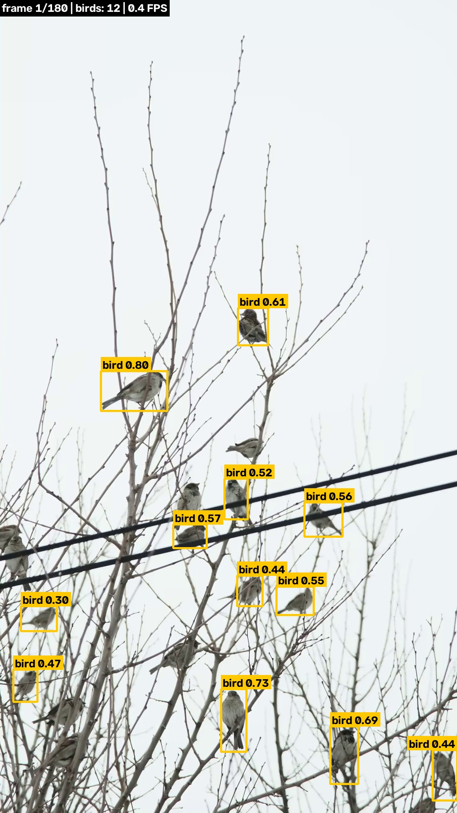
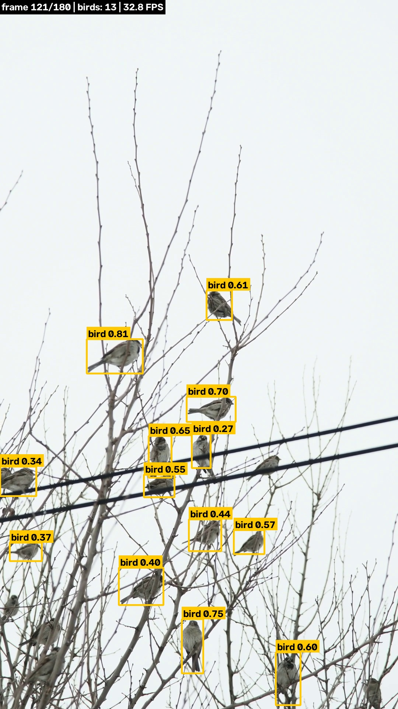
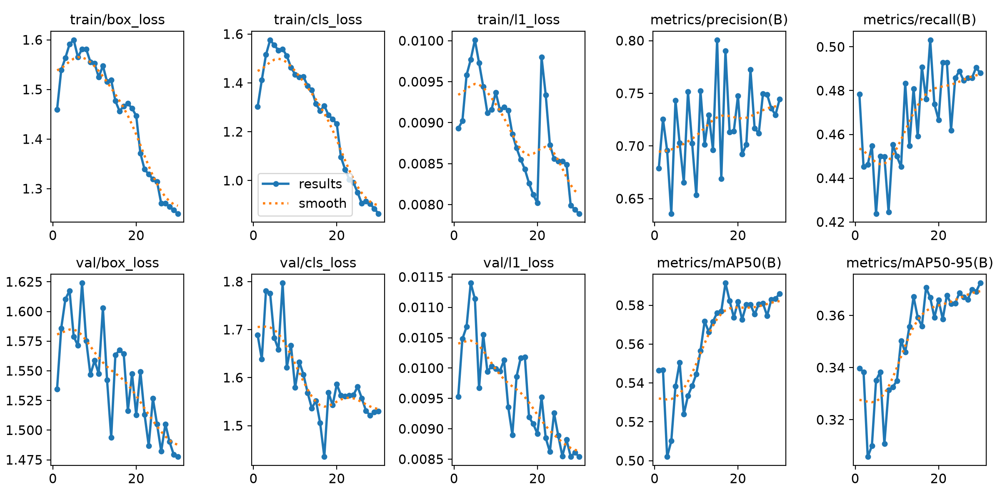
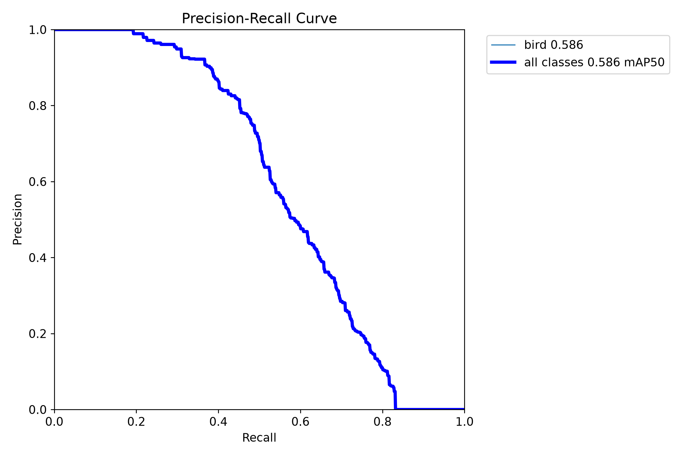

# bird-detector

Дотренування YOLO26n (`yolo26n.pt`) на фото птахів з COCO 2017 і детекція птахів на відео: вхідне відео → відео з рамками навколо птахів.

<p>
  
  
</p>

Відео з рамками: [examples/output.mp4](examples/output.mp4) (вхідне: [examples/input.mp4](examples/input.mp4)).

## Зміст

1. [Швидкий старт](#швидкий-старт)
2. [Встановлення](#встановлення)
3. [Підготовка датасету](#підготовка-датасету)
4. [Навчання](#навчання)
5. [Обробка відео](#обробка-відео)
6. [Датасет](#датасет)
7. [Результати](#результати)
8. [Проблеми, що виникли](#проблеми-що-виникли)
9. [Можливі покращення](#можливі-покращення)
10. [Структура проєкту](#структура-проєкту)

## Швидкий старт

Windows (PowerShell), GPU NVIDIA:

```powershell
git clone https://github.com/StanislavRakitianskiy/bird-detector.git
cd bird-detector
python -m venv .venv
.\.venv\Scripts\Activate.ps1
python -m pip install torch==2.14.1 torchvision==0.29.1 --index-url https://download.pytorch.org/whl/cu126
python -m pip install -r requirements.txt
python prepare_dataset.py --train-size 5000 --neg-ratio 0.3
python train.py --epochs 100 --out-dir runs/v4 --plots-dir runs/v4/plots
python train.py --model runs/v4/best.pt --epochs 30 --imgsz 960 --batch 4
python predict_video.py --input examples/input.mp4 --output examples/output.mp4 --imgsz 960
```

macOS / Linux:

```bash
git clone https://github.com/StanislavRakitianskiy/bird-detector.git
cd bird-detector
python3 -m venv .venv
source .venv/bin/activate
python -m pip install torch==2.14.1 torchvision==0.29.1
python -m pip install -r requirements.txt
python prepare_dataset.py --train-size 5000 --neg-ratio 0.3
python train.py --epochs 100 --out-dir runs/v4 --plots-dir runs/v4/plots
python train.py --model runs/v4/best.pt --epochs 30 --imgsz 960 --batch 4
python predict_video.py --input examples/input.mp4 --output examples/output.mp4 --imgsz 960
```

Навчені ваги вже є в репозиторії (`weights/best.pt`), тому підготовку датасету і два запуски `train.py` можна пропустити. На GTX 1650 Ti вони тривали 3:25:27 і 2:55:51. Другий `train.py` перезаписує `weights/best.pt`, `weights/metrics.json` і графіки в `examples/training/`.

## Встановлення

Перевірено на: Windows 11, Python 3.14.10, PyTorch 2.14.1+cu126, Ultralytics 8.4.203, GPU GeForce GTX 1650 Ti (4 ГБ).
Код написано сумісним з Python 3.10+, але запускався лише на Python 3.14.10 і лише на Windows.

Залежності (`requirements.txt`):

| Пакет | Версія |
|---|---|
| ultralytics | 8.4.203 |
| torch | 2.14.1 |
| torchvision | 0.29.1 |
| opencv-python | 5.0.0.93 |
| numpy | 2.5.4 |
| requests | 2.34.2 |
| tqdm | 4.70.1 |

Порядок важливий: спершу PyTorch окремою командою, потім `requirements.txt`. Якщо поставити тільки `requirements.txt`, pip візьме `torch` зі звичайного PyPI — на Windows це збірка без CUDA, і все працюватиме на процесорі.

### Windows (PowerShell)

```powershell
python -m venv .venv
.\.venv\Scripts\Activate.ps1
python -m pip install torch==2.14.1 torchvision==0.29.1 --index-url https://download.pytorch.org/whl/cu126
python -m pip install -r requirements.txt
```

Якщо PowerShell не дає запустити `Activate.ps1` (політика виконання скриптів), можна не активувати середовище, а викликати Python з нього напряму:

```powershell
.\.venv\Scripts\python.exe train.py --help
```

### macOS / Linux

```bash
python3 -m venv .venv
source .venv/bin/activate
python -m pip install torch==2.14.1 torchvision==0.29.1
python -m pip install -r requirements.txt
```

На macOS CUDA немає; `train.py` сам вибере `mps` (GPU Apple), якщо він доступний, інакше `cpu`.
На Linux з GPU NVIDIA PyTorch ставте командою з розділу нижче.

### PyTorch з CUDA

- Збірка з CUDA ставиться з окремого індексу PyTorch. Проєкт перевірено з CUDA 12.6 (`cu126`):

  ```bash
  python -m pip install torch==2.14.1 torchvision==0.29.1 --index-url https://download.pytorch.org/whl/cu126
  ```

- Команди для інших версій CUDA і для CPU — на [pytorch.org/get-started/locally](https://pytorch.org/get-started/locally/).
- Окремо ставити CUDA Toolkit не треба (потрібні бібліотеки є в пакеті torch), потрібен лише свіжий драйвер NVIDIA.
- Після встановлення `requirements.txt` pip не замінить CUDA-збірку: версія `2.14.1+cu126` задовольняє вимогу `torch==2.14.1`.
- Перевірка:

  ```bash
  python -c "import torch; print(torch.__version__, torch.cuda.is_available())"
  ```

  Очікується `2.14.1+cu126 True`. Якщо `False` — стоїть CPU-збірка або не бачиться драйвер.

## Підготовка датасету

Конфігурація, на якій навчено `weights/best.pt`:

```bash
python prepare_dataset.py --train-size 5000 --neg-ratio 0.3
```

Що завантажується:

- архів розмітки COCO `annotations_trainval2017.zip` — 252 907 541 байт (~253 МБ), один раз, зберігається в `datasets/_downloads/`;
- фото — по одному з `images.cocodataset.org`. З параметрами вище: 4207 фото train (~711 МБ) і 163 фото val (~29 МБ).

Читання JSON-розмітки COCO займає до хвилини і кілька ГБ оперативної пам'яті. Повторний запуск не качає вже завантажені фото, а файли зі старих запусків (з іншим `--train-size`) видаляє.

`--train-size 5000` більше, ніж є фото з птахами в train2017 після фільтрів, тому скрипт попереджає і бере всі — вийшло 3236.

| Аргумент | За замовчуванням | Що робить |
|---|---|---|
| `--out` | `datasets/birds` | папка датасету (відносно кореня проєкту) |
| `--train-size` | `1500` | скільки фото з птахами взяти в train |
| `--neg-ratio` | `0.1` | частка фото без птахів відносно фото з птахами (в train і в val окремо) |
| `--seed` | `42` | зерно генератора випадкових чисел |
| `--workers` | `8` | кількість потоків для завантаження фото |
| `--preview` | `0` | зберегти N фото з намальованими рамками в `<out>/preview/` для перевірки конвертації |

Результат: `datasets/birds/images/{train,val}/`, `datasets/birds/labels/{train,val}/` (YOLO-розмітка), `datasets/birds/stats.json` (статистика) і `data/bird.yaml` (конфіг для Ultralytics).

## Навчання

```bash
python train.py
```

Скрипт:

1. перевіряє датасет і робить копію `data/bird.yaml` з абсолютним шляхом у `runs/bird_abs.yaml`;
2. донавчає модель; результати Ultralytics — у `runs/<name>/`;
3. копіює найкращі ваги в `<out-dir>/best.pt`, графіки — в `<plots-dir>/`;
4. окремо перевіряє збережені ваги на val і пише метрики, параметри та статистику датасету в `<out-dir>/metrics.json`.

| Аргумент | За замовчуванням | Що робить |
|---|---|---|
| `--data` | `data/bird.yaml` | конфіг датасету |
| `--model` | `yolo26n.pt` | стартові ваги (шлях від кореня проєкту; якщо файлу немає — Ultralytics завантажить сам) |
| `--epochs` | `50` | максимальна кількість епох |
| `--imgsz` | `640` | розмір картинки при навчанні |
| `--batch` | `8` | розмір батча |
| `--device` | авто | `0` (перший GPU), `mps` або `cpu`; авто: cuda → mps → cpu |
| `--patience` | `15` | зупинити навчання, якщо якість не росте стільки епох поспіль |
| `--seed` | `42` | зерно генератора випадкових чисел |
| `--workers` | `4` | кількість процесів, що читають дані |
| `--fraction` | `1.0` | яку частку train брати (для швидких тестів); val береться повністю |
| `--name` | `bird` | назва запуску: результати в `runs/<name>` (якщо папка вже є, Ultralytics створить нову з номером) |
| `--no-amp` | вимкнено | вимкнути змішану точність (AMP), якщо в loss з'являється `nan` |
| `--out-dir` | `weights` | куди покласти `best.pt` і `metrics.json` |
| `--plots-dir` | `examples/training` | куди скопіювати графіки навчання |

`weights/best.pt` отримано у два етапи (датасет `--train-size 5000 --neg-ratio 0.3`):

```bash
python train.py --epochs 100 --out-dir runs/v4 --plots-dir runs/v4/plots
python train.py --model runs/v4/best.pt --epochs 30 --imgsz 960 --batch 4
```

Перший етап донавчає `yolo26n.pt` на `imgsz 640` і кладе результат у `runs/v4/`. Другий дотреновує його на `imgsz 960` і пише в `weights/`.

Якщо не вистачає відеопам'яті — спершу зменшуйте `--batch` (4, 2), потім `--imgsz` (наприклад, 512).

### Дим-тест

Одна епоха на 10% train — перевірка, що все встановлено й запускається. Результати йдуть у `runs/smoke_out/`, тому `weights/` не перезаписується:

```bash
python train.py --epochs 1 --fraction 0.1 --name smoke --out-dir runs/smoke_out --plots-dir runs/smoke_out/plots
```

На GTX 1650 Ti (датасет за замовчуванням) навчання зайняло 31 с. Метрики після однієї епохи близькі до нуля — це нормально.

### Google Colab

У Colab проєкт не перевірявся. Загальна схема (Runtime → Change runtime type → GPU):

```text
!git clone https://github.com/StanislavRakitianskiy/bird-detector.git
%cd bird-detector
!pip install -r requirements.txt
!python prepare_dataset.py --train-size 5000 --neg-ratio 0.3
!python train.py --epochs 100 --out-dir runs/v4 --plots-dir runs/v4/plots
!python train.py --model runs/v4/best.pt --epochs 30 --imgsz 960 --batch 4
```

Файли Colab зберігаються лише до кінця сесії — після навчання завантажте `weights/best.pt` і `weights/metrics.json` до себе.

## Обробка відео

```bash
python predict_video.py --input examples/input.mp4 --output examples/output.mp4
```

Модель обробляє кожен кадр, малює рамки з підписом `bird 0.87` і рядок стану (номер кадру, кількість птахів, FPS обробки). Поруч з вихідним відео зберігаються кадри-приклади `<output>_1.jpg`, `<output>_2.jpg`, ... Відео пишеться кодеком H.264 (`avc1`), а якщо він недоступний — `mp4v`.

| Аргумент | За замовчуванням | Що робить |
|---|---|---|
| `--input` | — (обов'язковий) | вхідне відео |
| `--output` | `examples/output.mp4` | куди зберегти відео з рамками |
| `--weights` | `weights/best.pt` | ваги моделі; для порівняння можна `yolo26n.pt` |
| `--conf` | `0.25` | мінімальна впевненість (0..1], слабші детекції відкидаються |
| `--nested` | `0.8` | прибрати рамку, якщо така частка її площі лежить усередині впевненішої рамки; `0` — не прибирати |
| `--imgsz` | `640` | розмір, до якого модель зменшує кадр |
| `--device` | авто | `0` (перший GPU) або `cpu` |
| `--show` | вимкнено | показувати кадри у вікні під час обробки (`q` або `Esc` — зупинити) |
| `--save-frames` | `3` | скільки кадрів з птахами зберегти як jpg (`0` — не зберігати) |

`weights/best.pt` навчено на `imgsz 960`, а скрипт за замовчуванням зменшує кадр до 640. `examples/output.mp4` зроблено з розміром навчання — так модель знаходить майже вдвічі більше горобців (див. [На відео](#на-відео)):

```bash
python predict_video.py --input examples/input.mp4 --output examples/output.mp4 --imgsz 960
```

Якщо на відео багато хибних рамок на дрібних деталях — підніміть поріг:

```bash
python predict_video.py --input examples/input.mp4 --output examples/output.mp4 --conf 0.6
```

## Датасет

**Джерело:** [COCO 2017](https://cocodataset.org/), клас `bird`. Розмітка — архів [annotations_trainval2017.zip](http://images.cocodataset.org/annotations/annotations_trainval2017.zip), фото — з `images.cocodataset.org`.

**Ліцензія** ([COCO Terms of Use](https://cocodataset.org/#termsofuse)): розмітка належить COCO Consortium і поширюється за ліцензією [Creative Commons Attribution 4.0](https://creativecommons.org/licenses/by/4.0/). Авторських прав на фото COCO Consortium не має — їх використання підпорядковується умовам Flickr. Тому фото в репозиторій не додано: `prepare_dataset.py` завантажує їх сам.

**Розмір** (`datasets/birds/stats.json`, `--train-size 5000 --neg-ratio 0.3 --seed 42`):

| | train (з train2017) | val (з val2017) |
|---|---|---|
| Фото всього | 4207 | 163 |
| з птахами | 3236 | 125 |
| без птахів | 971 | 38 |
| Рамок птахів | 10470 | 420 |
| Птахів на фото з птахами (у середньому) | 3.24 | 3.36 |
| Малих рамок (площа < 32×32 px) | 5538 (52.9%) | 227 (54.1%) |

**Чому val — це COCO val2017.** Готову модель `yolo26n.pt` навчено на COCO train2017, тобто фото train2017 вона вже бачила. Якщо перевіряти на них, метрики будуть завищені. Фото val2017 модель при навчанні не бачила. У val беруться всі фото з птахами з val2017; вони відбираються до train, тому val не залежить від `--train-size`, і запуски з різним розміром train порівнюються на тих самих фото з птахами.

**Навіщо фото без птахів.** На таких фото модель вчиться не ставити рамки на фон і предмети, схожі на птаха (гілки, листя, дрібні деталі). Для YOLO це фото з порожнім файлом розмітки. У «фото без птахів» не потрапляють фото, де є хоч одна розмічена птиця — навіть та, чию рамку відкинуто фільтром.

**Фільтри.** Відкидаються рамки `iscrowd` (одна рамка на зграю) і рамки, де ширина або висота менша за 2 px.

**Конвертація рамки.** COCO зберігає рамку як `[x, y, w, h]` у пікселях, де `(x, y)` — верхній лівий кут. YOLO потрібні центр і розміри в частках від розміру фото (0..1). Рамку спершу обрізають до меж фото, потім:

```text
x1 = max(0, x)          y1 = max(0, y)
x2 = min(W, x + w)      y2 = min(H, y + h)
xc = (x1 + x2) / 2 / W  yc = (y1 + y2) / 2 / H
w' = (x2 - x1) / W      h' = (y2 - y1) / H
рядок файлу: 0 xc yc w' h'      (0 — клас bird)
```

Правильність конвертації можна перевірити: `--preview N` малює рамки, прочитані назад з YOLO-файлів.

**Вхідне відео** `examples/input.mp4`: [Pexels, відео 35595578](https://www.pexels.com/uk-ua/video/35595578/) — горобці на гілках, 1080×1920, 29.97 FPS, 180 кадрів (6 с). Ліцензія [Pexels](https://www.pexels.com/license/): безкоштовне використання і зміна, зазначення автора не обов'язкове.

## Результати

Метрики `weights/best.pt` на val (з `weights/metrics.json`, перевірка на `imgsz 960`):

| Метрика | Значення | Що означає |
|---|---|---|
| Precision | 0.7488 | З усіх рамок, які намалювала модель, 75% — справді птахи. |
| Recall | 0.4896 | Модель знайшла 49% птахів із розмітки val. |
| mAP50 | 0.5857 | Загальна оцінка якості за всіх порогів впевненості; рамка вважається правильною, якщо збігається з розміткою хоча б наполовину (IoU ≥ 0.5). |
| mAP50-95 | 0.3717 | Те саме, але з суворішими вимогами до збігу (IoU від 0.50 до 0.95) — показує, наскільки точно рамка обводить птаха. |

IoU — площа перетину двох рамок, поділена на площу їх об'єднання. Precision і recall Ultralytics рахує при порозі впевненості, де F1 найбільший.

Параметри навчання (`runs/v4/metrics.json` і `weights/metrics.json`):

| Параметр | Етап 1 (v4) | Етап 2 (v5, `weights/best.pt`) |
|---|---|---|
| Стартові ваги | `yolo26n.pt` | `runs/v4/best.pt` |
| Епохи | максимум 100; пройдено 87 (рання зупинка, `patience=15`), найкраща — 72 | 30 з 30, найкраща — остання |
| imgsz | 640 | 960 |
| batch | 8 | 4 |
| Пристрій | NVIDIA GeForce GTX 1650 Ti (4 ГБ) | те саме |
| AMP | не використовувався: Ultralytics вимикає його на GTX 16xx автоматично | те саме |
| Оптимізатор, seed, workers | `auto` (вибирає Ultralytics), 42, 4 | те саме |
| Час навчання (з валідацією після кожної епохи) | 3:25:27 | 2:55:51 |

Версії: Python 3.14.10, torch 2.14.1+cu126, ultralytics 8.4.203.

### Графіки

Графіки етапу 2 (v5) з `examples/training/`:





Інші графіки: [F1 від порогу](examples/training/BoxF1_curve.png), [precision від порогу](examples/training/BoxP_curve.png), [recall від порогу](examples/training/BoxR_curve.png), [матриця помилок](examples/training/confusion_matrix.png).

### Порівняння версій

Усі версії — `yolo26n`, seed 42. У val скрізь ті самі 125 фото з птахами (420 рамок); фото без птахів у val: v1–v3 — 12, v4–v5 — 38, тому precision між цими групами порівнюється не зовсім рівно. Метрики v1 — з `weights/metrics.json` у коміті `c8a3884`.

| Версія | Що змінено | Train: фото з птахами / без | Епох пройдено / найкраща | Час | Precision | Recall | mAP50 | mAP50-95 |
|---|---|---|---|---|---|---|---|---|
| v1 | старт: `yolo26n.pt`, усі аргументи за замовчуванням (`--epochs 50`, датасет `--train-size 1500 --neg-ratio 0.1`) | 1500 / 150 | 50 / 50 | 0:48:20 | 0.7546 | 0.4476 | 0.5390 | 0.3436 |
| v2 | `--epochs 100` | 1500 / 150 | 80 / 65 | 1:19:02 | 0.7451 | 0.4500 | 0.5408 | 0.3258 |
| v3 | `--train-size 5000` | 3236 / 324 | 63 / 48 | 2:10:50 | 0.7899 | 0.4475 | 0.5557 | 0.3505 |
| v4 | `--neg-ratio 0.3` | 3236 / 971 | 87 / 72 | 3:25:27 | 0.7619 | 0.4643 | 0.5653 | 0.3549 |
| **v5** (`weights/`) | дотренування v4: `--model runs/v4/best.pt --epochs 30 --imgsz 960 --batch 4` | 3236 / 971 | 30 / 30 | 2:55:51 | 0.7488 | 0.4896 | 0.5857 | 0.3717 |

### На відео

Рамки на кадр на `examples/input.mp4` (180 кадрів, `--conf 0.25`, `--nested 0.8`). Це «Усього детекцій» з логу `predict_video.py`, поділене на кількість кадрів:

| Модель | `--imgsz` | Рамок на кадр, у середньому | Мінімум–максимум |
|---|---|---|---|
| v4 | 640 | 8.6 | 5–12 |
| v5 | 640 | 6.5 | 3–10 |
| v5 (`examples/output.mp4`) | 960 | 12.5 | 9–16 |

Це кількість рамок, а не перевірених птахів. На трьох кадрах-прикладах (`examples/output_*.jpg`) усі рамки стоять на горобцях, але частина горобців лишається без рамок.

### Інтерпретація

Precision (0.75) помітно вищий за recall (0.49): якщо модель ставить рамку, це здебільшого птах, але половину птахів із val вона пропускає. Головна причина — дрібні птахи: 54% рамок у val менші за 32×32 px. Дотренування на `imgsz 960` (v5) підняло recall і mAP на val. На відео з горобцями цю перевагу видно лише тоді, коли кадр обробляється на тому самому розмірі, що й при навчанні: на `imgsz 640` v5 знаходить навіть менше рамок, ніж v4, а на 960 — майже вдвічі більше. Але й тоді частина дрібних птахів лишається без рамок. Добре модель працює на великих і середніх птахах: птахи в небі (відео 2, v1), птах з довгим хвостом як одна рамка (відео 3, v5), птах посеред кадру на середній дистанції (відео 4, v5). Помиляється на дрібних і далеких птахах, а також ставить рамки на схожі предмети: болти на рейках, листя, камінь. Різниця між mAP50 (0.59) і mAP50-95 (0.37) означає, що рамки часто стоять неточно: для дрібного птаха зсув на кілька пікселів сильно зменшує IoU. На графіках етапу 2 loss на val ще падає, а mAP50-95 ще росте на останній, 30-й епосі — модель не дотренована до кінця.

## Проблеми, що виникли

Тестові відео — з Pexels: [1](https://www.pexels.com/uk-ua/video/37601335/), [2](https://www.pexels.com/uk-ua/video/11933670/), [3](https://www.pexels.com/uk-ua/video/7008041/), [4](https://www.pexels.com/uk-ua/video/16466804/), [5](https://www.pexels.com/uk-ua/video/35595578/) (це `examples/input.mp4`).

- **Рамки на дрібних деталях** (болти на рейках, відео 1, v1) → поріг `--conf` піднято з 0.25 до 0.6; після цього лишилась лише рамка на голубі.
- **Дві рамки на одного птаха з довгим хвостом** — «тіло» всередині рамки «птах з хвостом» (відео 3). Вбудований у YOLO NMS прибирає пару рамок лише при IoU ≥ 0.7, а тут IoU був 0.31–0.64, бо мала рамка вдвічі менша за велику → на v1 допоміг `--conf 0.6`; у `predict_video.py` додано фільтр `--nested`: рамка прибирається, якщо ≥ 80% її площі лежить усередині впевненішої. Модель v5 бачить птаха з хвостом як одну рамку.
- **Хибні птахи на фоні** (камінь; листя наприкінці відео 4, v5) → не вирішено.
- **Дрібні птахи і низький recall** → v3: усі фото з птахами з train2017 (3236 замість 1500); v5: дотренування на `imgsz 960`. Recall на val зріс з 0.45 (v1) до 0.49 (v5), але на відео 5 частина горобців досі без рамок — не вирішено до кінця.
- **v5 на відео майже не відрізнялась від v4** → відео оброблялось на `imgsz 640`, а v5 навчено на 960. З `--imgsz 960` рамок на кадр стало в середньому 12.5 замість 6.5.
- **Великий розмір вихідного відео** (67 МБ після обробки відео 1) → вхідне відео обрізано до 10 с.

## Можливі покращення

1. **Брати `--imgsz` за замовчуванням із самих ваг** (у них записано розмір навчання). Проблема: `predict_video.py` за замовчуванням зменшує кадр до 640, і якщо забути `--imgsz 960`, v5 на відео працює гірше за v4 (див. [На відео](#на-відео)).
2. **Довше навчання на `imgsz 960` або більшому.** Проблема: низький recall на дрібних птахах. На етапі 2 найкраща епоха — остання (30 з 30), метрики ще ростуть.
3. **Обробка кадру частинами (тайлами).** Проблема: дрібні й далекі птахи на кадрі 1080×1920. Кадр ріжеться на фрагменти з перекриттям, кожен обробляється в повній роздільності, рамки потім зводяться разом. Можна зробити в `predict_video.py` без нових бібліотек.
4. **Більше даних з дрібними птахами** (інші відкриті датасети з птахами, після перевірки ліцензій). Проблема: низький recall на дрібних птахах і різниця між фото COCO та кадрами реального відео (зграї, розмиття, далекий план).
5. **Hard negatives — кадри з помилками як фото без птахів.** Проблема: хибні рамки на листі, камені, болтах. Кадри з тестових відео, де модель помилилась, додаються в train з порожньою розміткою.
6. **Трекінг між кадрами** (`model.track` з вбудованим в Ultralytics ByteTrack). Проблема: рамки мерехтять — птах зникає на окремих кадрах, зайва рамка на хвості з'являється лише на деяких кадрах. Трекер згладжує результат у часі.
7. **Детальніша оцінка: метрики окремо для малих, середніх і великих птахів і порівняння з готовою `yolo26n.pt` на тій самій val.** Проблема: одна загальна цифра не показує, де саме модель помиляється, і невідомо, наскільки дотренування покращило клас `bird` порівняно з готовою моделлю.

## Структура проєкту

```text
bird-detector/
├── README.md             # цей файл
├── CLAUDE.md             # правила для AI-асистента в цьому проєкті
├── NOTES.md              # нотатки: тестові відео, проблеми, метрики v1
├── requirements.txt      # прямі залежності з точними версіями
├── .gitignore
├── prepare_dataset.py    # готує датасет з COCO 2017 у datasets/birds (формат YOLO)
├── train.py              # навчання; best.pt і metrics.json кладе в weights/
├── predict_video.py      # детекція птахів на відео: вхідне відео → відео з рамками
├── data/
│   └── bird.yaml         # конфіг датасету для Ultralytics (генерує prepare_dataset.py)
├── weights/
│   ├── best.pt           # найкращі ваги (v5)
│   └── metrics.json      # метрики v5 на val, параметри навчання, статистика датасету
└── examples/
    ├── input.mp4         # вхідне відео (Pexels)
    ├── output.mp4        # результат predict_video.py (v5, --imgsz 960)
    ├── output_1.jpg      # кадри-приклади з output.mp4
    ├── output_2.jpg
    ├── output_3.jpg
    └── training/         # графіки навчання v5 (results.png, криві P/R/F1/PR, матриця помилок)
```

Поза git (`.gitignore`): `.venv/`, `datasets/` (фото і розмітка), `runs/` (усі запуски Ultralytics), `*.pt` у корені (стартові ваги `yolo26n.pt`).
